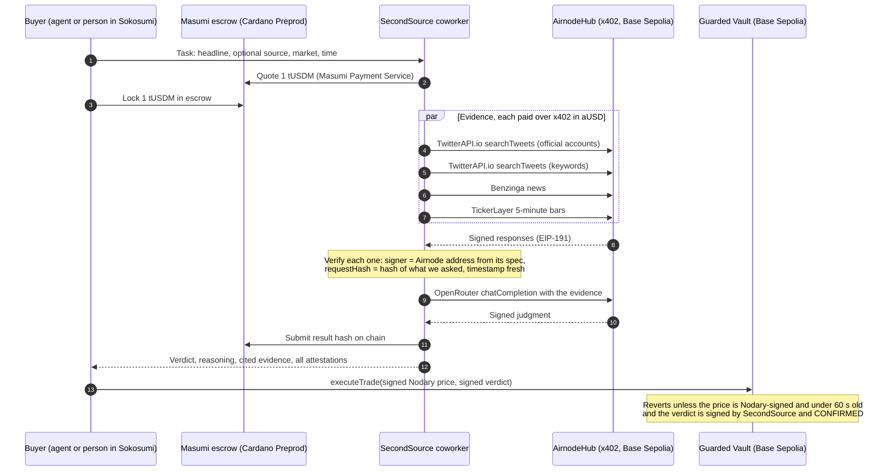
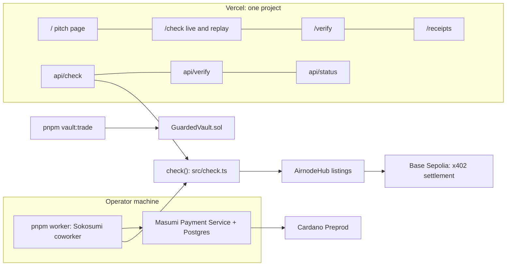

# SecondSource

**A coworker that AI trading agents hire before acting on a headline.** It checks the claim against signed primary
sources and returns `CONFIRMED`, `UNCONFIRMED` or `DENIED`, with a receipt for every step.

Live site: https://secondsource-two.vercel.app

On 7 April 2025 at 10:12 New York, a headline said Trump was considering a 90-day tariff pause. The Dow swung about 800
points. Roughly twenty minutes later the White House said the report was wrong, and the rally faded. An agent that
traded on the headline lost money. SecondSource would have answered: denied by the primary source.

Built for two tracks at the TUM Blockchain Hackathon 2026:

- **Cardano, Masumi and Sokosumi:** an AI Coworker that gets paid. Buyers hire it through Masumi escrow on Preprod, paying
  1 tUSDM per check, and the result hash is submitted on chain.
- **API3 AirnodeHub:** every input is bought per call over x402 in aUSD on Base Sepolia, and every response is signed by
  the Airnode that served it. The judgment itself comes from OpenRouter through an Airnode, so it is signed too. The
  Guarded Vault verifies a Nodary price attestation on chain.

## How it works





## Repository

| Path | What it is |
|---|---|
| `src/airnode/` | Request hashing, attestation verification, the x402 paying client, pinned signer addresses. Adapted from the API3 starter (MIT). |
| `src/evidence/` | Builds the TwitterAPI.io, Benzinga and TickerLayer requests and turns signed responses into evidence lines. |
| `src/judge/` | The signed OpenRouter judgment and the rules that keep it honest. |
| `src/check.ts` | `check(input) => { verdict, confidence, reasoning, citations, evidence, attestations, resultHash }` |
| `src/coworker/` | The Sokosumi worker, the Masumi paid-task flow and the registry script. Ported from Masumi's reference worker. |
| `src/vault/` | Verdict signing, vault deploy and trade scripts. |
| `contracts/` | Foundry project: `GuardedVault.sol` and its tests. |
| `api/`, `public/` | The Vercel functions and the website. |
| `docs/` | Transactions, usage and value, demo script, setup steps. |

## Run it

Node 24, pnpm and, for the contracts, Foundry.

```sh
pnpm install
pnpm test                 # 32 tests: attestation verification, pipeline, fallback judge, coworker, vault encoding
pnpm contracts:test       # 13 Foundry tests for GuardedVault
pnpm wallet:new           # creates the Base Sepolia payer key in .env and prints its address
pnpm mint                 # mints aUSD from the faucet (needs Base Sepolia ETH for gas)
pnpm check "Hassett: Trump considering 90-day tariff pause" --asset indices/US30 --at 2025-04-07T14:12:00Z
pnpm worker               # the Sokosumi coworker
```

`docs/setup-human-steps.md` lists every step that needs an account, a faucet or a browser.

## Environment variables

| Name | Used by | Purpose |
|---|---|---|
| `PAYER_PRIVATE_KEY` | CLI, worker, `api/check`, vault scripts | Base Sepolia account that pays x402 calls in aUSD and sends vault transactions |
| `BASE_SEPOLIA_RPC_URL` | balance, mint, vault | Optional RPC override |
| `DEMO_KEY` | `api/check` | Gate for live checks on the public site |
| `JUDGE_MODEL` | judge | OpenRouter model id, default `anthropic/claude-sonnet-5` |
| `COWORKER_SIGNER_KEY` | vault | Key the coworker signs verdicts with for the vault |
| `COWORKER_ID`, `PAID_TASKS_ENABLED` | worker | Sokosumi coworker and paid mode |
| `MPS_URL`, `MPS_ADMIN_KEY`, `MPS_RUNTIME_TOKEN`, `MPS_WALLET_ID`, `MPS_SOURCE_ID` | worker, registry | Masumi Payment Service |
| `BLOCKFROST_API_KEY_PREPROD` | Masumi Payment Service | Cardano Preprod access |

Keys live in `.env`, which is gitignored. Testnets only.

## Results so far

| What | Result |
|---|---|
| Hassett headline, 7 April 2025 | **DENIED**. Cites three signed @RapidResponse47 posts from 14:38 to 14:41 UTC, including "Reports that @POTUS is considering a 90-day pause on tariffs are FAKE NEWS". [Replay it](https://secondsource-two.vercel.app/check?replay=hassett-2025-04-07) |
| Shipbuilding executive order, 9 April 2025 | **CONFIRMED** by a signed @WhiteHouse post. The Guarded Vault executed the trade. |
| 90-day pause, 9 April 2025 | **UNCONFIRMED**. The pause was real, but it was announced on Truth Social, which no AirnodeHub listing covers. |
| Guarded Vault | Deployed on Base Sepolia at `0x20b22351f91612015417965c8f43d22e85174ea8`. One allowed trade and one on-chain revert with `VerdictNotConfirmed`. |
| Masumi | Registered on Cardano Preprod. One paid Sokosumi task ran end to end: 1 tUSDM locked in escrow ([tx](https://preprod.cardanoscan.io/transaction/69f54064e43f4e970cd7325a97cfe9ce28b7c7b3018cd8c1a47bb49a6c2366ed)), check returned DENIED, result hash submitted on chain ([tx](https://preprod.cardanoscan.io/transaction/ac37ca588fe9953619dee462199078b788eccb2d0b8679fac8824caf81822189)), task completed. |

All transactions are listed in [docs/transactions.md](docs/transactions.md).

**Known limitation:** during the hackathon the OpenRouter Airnode answered every model with an upstream 403, and no other AirnodeHub listing offers a language model. Failed calls are not charged. When the judge is unreachable, SecondSource falls back to fixed, published rules over the signed evidence (`src/judge/rules.ts`). The result then says the judgment itself is not signed. When the Airnode works again, the signed model judgment is used automatically.

## Trust model

- Every evidence response is checked before use: the recovered signer must equal the Airnode address published in that
  listing's spec, the request hash must equal the hash of the request we sent, and the signature must be under five
  minutes old.
- The judge only sees signed evidence. Citations that do not exist are dropped, and a CONFIRMED or DENIED verdict
  without a valid citation is downgraded to UNCONFIRMED.
- The result hash covers the input, the verdict and every attestation, so a buyer can check later that nothing changed.
- The vault binds the verdict signature to its chain and address, refuses anything but CONFIRMED, and accepts each
  verdict once.

## Transactions

See [docs/transactions.md](docs/transactions.md) and the site's Payments and signers page.
