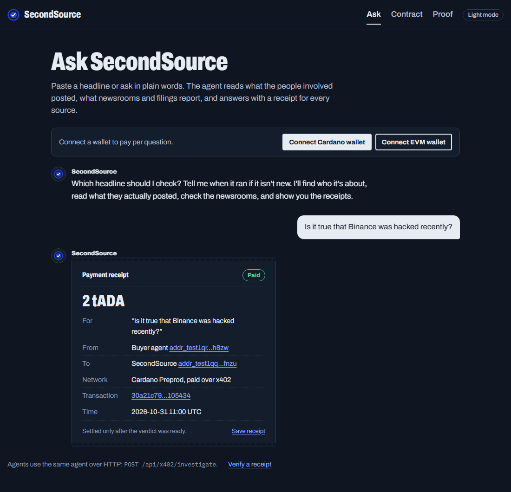
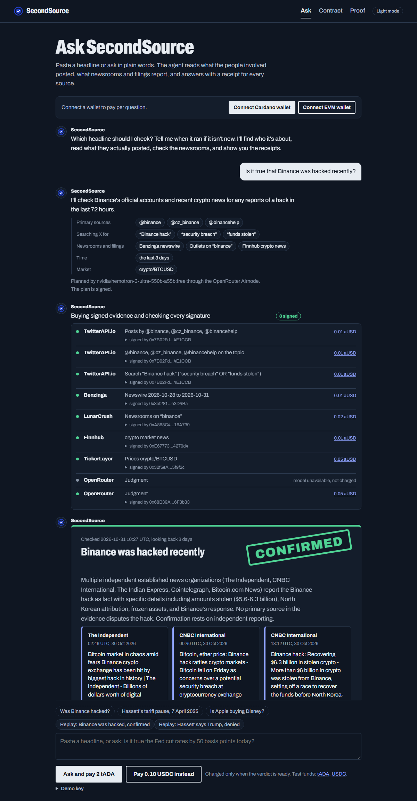
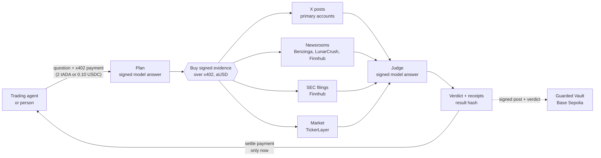
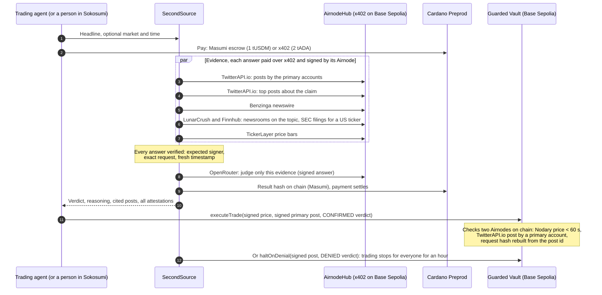

<div align="center">


# SecondSource

### Trust the primary source, not the headline.

The coworker AI trading agents hire before they act on a headline. It reads what the people involved actually posted,
what newsrooms and filings report, and answers **CONFIRMED**, **UNCONFIRMED** or **DENIED**, with a signed receipt
for every source and a payment that settles only after the verdict is delivered.

[](https://github.com/raglibol-re/SecondSource/actions/workflows/ci.yml)


**[Ask it live](https://secondsource-two.vercel.app/check)** |
**[Run the tamper test](https://secondsource-two.vercel.app/vault?run)** |
**[See every transaction](https://secondsource-two.vercel.app/receipts)** |
[Contract on BaseScan](https://sepolia.basescan.org/address/0x0e9128f550254ed3389330e8134cea8cb09f46b6)

</div>

---

## Two headlines, two verdicts

| The headline | Verdict | Why | Watch it |
|---|---|---|---|
| "Binance was hacked" (asked 31 Oct 2026, no date given) | **CONFIRMED**, 80% | CNBC, Cointelegraph, Fox Business, ABC News and others report the $6.3B hack as fact, and no Binance account disputes it | [Replay](https://secondsource-two.vercel.app/check?replay=binance-hack-2026-10-31) |
| "Hassett: Trump considering 90-day tariff pause" (7 Apr 2025, 10:12 New York) | **DENIED** | @RapidResponse47's own posts, signed by the TwitterAPI.io Airnode: "Wrong. Fake News." | [Replay](https://secondsource-two.vercel.app/check?replay=hassett-agent-2025-04-07) |

The second headline moved the Dow about 800 points before the White House called it fake. The correction was on the
primary source's own account the whole time; nothing checked it before the orders went out.

<p align="center">
  
  
</p>

## How it works



1. **Plan.** A model, called through the OpenRouter Airnode so its answer is signed, reads the question and picks the
   primary accounts, search words, news feeds, time window and market.
2. **Buy evidence.** SecondSource pays each AirnodeHub listing per call over x402 and accepts an answer only if it is
   signed by the expected key, answers the exact request, and is fresh.
3. **Judge.** A second signed model call weighs only that evidence. An official denial beats everything; independent
   newsrooms can confirm an event, capped at 80%.
4. **Deliver, then get paid.** The buyer's x402 payment on Cardano or Base settles only after the verdict exists. A
   Masumi job puts the result hash on chain before SecondSource collects.
5. **Act on chain.** The Guarded Vault trades only after it verifies, itself, a fresh Nodary price and the cited post
   signed by the TwitterAPI.io Airnode.

## Why you can trust the output

| Guarantee | How | Check it |
|---|---|---|
| No evidence is invented or edited | Every answer is an Airnode signature over request, timestamp and data; signer, request hash and age are verified | [`/verify`](https://secondsource-two.vercel.app/verify), `src/airnode/verify.ts` |
| You see what the model saw and said | Planner and judge run through the OpenRouter Airnode, so both answers are signed too | Receipts in every result |
| The result can't change afterwards | One result hash covers question, verdict and all signed answers; Masumi writes it on Cardano | [Result hash on chain](https://preprod.cardanoscan.io/transaction/721423f3f8809c86bd7ae6a3b0127c8454ef1ef1384d89899716b3808ece4879) |
| You pay only for delivered work | x402 settles after the verdict; a failed run is never settled; escrow refunds without a result | `api/x402/investigate.ts`, `test/settlement.test.ts` |
| The contract doesn't take our word for it | It rebuilds the post's request hash, verifies the TwitterAPI.io signature and the author on chain | `pnpm tamper-test`, [`SECURITY.md`](SECURITY.md) |

Limits, plainly: a signature proves what a source said, not that it is true, and the model can misjudge. That is why
money only moves in the vault on a primary source's own signed words.

## For judges: one minute per track

**API3, tamper test (pass/fail).** Open https://secondsource-two.vercel.app/vault?run, or run:

```sh
pnpm tamper-test
```

```
1. Valid, timely response from the Nodary Airnode          ACCEPTED: ETH/USD 2245.69
2. Real response with one value edited                     REVERTED SignatureMismatch
3. Real response that is too old                           REVERTED PriceResponseTooOld
4. Real response to a different request (BTC/USD)          REVERTED WrongRequest
5. Response signed by a key that is not the Nodary Airnode REVERTED UnexpectedAirnode
1 accepted, 4 rejected with 4 distinct reasons: PASS (1.3 s)
```

Each case calls `verifyPrice` on the deployed contract (eth_call, no gas, no keys). To send your own response, paste it
on `/vault`, POST it to `https://secondsource-two.vercel.app/api/vault/verify`, or run
`pnpm vault:verify response.json` (`--post <id>` for a TwitterAPI.io post, `--fresh` for a new signed price). The
same five cases run offline as Foundry tests: `pnpm tamper-test --offline`.

**Cardano, a paid job from start to finish.** A Sokosumi task paid 1 tUSDM through Masumi escrow on Preprod. The check
returned DENIED with a signed model judgment, the result hash went on chain, the task completed and SecondSource
collected the payment:

| Step | Cardano Preprod transaction |
|---|---|
| Escrow funded (FundsLocked) | [b74e743b…](https://preprod.cardanoscan.io/transaction/b74e743b2848b4919a73c99a814ad92471f5971d4aba15bd1e0ad3cd5fa086f3) |
| Result hash on chain (ResultSubmitted) | [721423f3…](https://preprod.cardanoscan.io/transaction/721423f3f8809c86bd7ae6a3b0127c8454ef1ef1384d89899716b3808ece4879) |
| Payout to SecondSource (Withdrawn) | [665cf3d5…](https://preprod.cardanoscan.io/transaction/665cf3d555452c066826138e7dff9969191a4221331572ca9f389c5a717bd877) |
| Paid request over x402 (2 tADA) | [7616f0a5…](https://preprod.cardanoscan.io/transaction/7616f0a56d346e068d7af71f167ef8cbee8e12dc63eef3acec5cd8d0ba29cc44) |
| Live paid investigation over x402 (2 tADA), 31 Oct, verdict CONFIRMED | [30a21c79…](https://preprod.cardanoscan.io/transaction/30a21c79a0a8662dcf93ed5f0f4290894c05b8001193c95bd9b9f00e19105434) |

**Ask it yourself, in the browser.** On https://secondsource-two.vercel.app/check, type a question about a headline in
plain words (or pick a suggestion). Pay with either wallet:
- **Cardano:** "Connect Cardano wallet", then "Ask and pay 2 tADA" (Eternl or Lace on preprod; test ADA at
  https://dispenser.masumi.network).
- **USDC:** "Connect EVM wallet", then "Ask and pay 0.10 USDC" (MetaMask or any EVM wallet on Base Sepolia, signed once, no gas; test USDC
  at https://faucet.circle.com).

The agent then plans the check: which primary accounts, which search words, which time window and market. You watch
it buy and verify each signed answer, and get the verdict in the chat. Agents use the same thing over HTTP at
`POST /api/x402/investigate` (`pnpm x402:buy --question "…"`).

Payment is tied to the result. The x402 payment settles only after the check succeeded, and Masumi escrow refunds the
buyer if no result hash is submitted before the deadline.

**TUM Blockchain Track.** See [`SECURITY.md`](SECURITY.md) for the threat model, trust assumptions and limits, and
[`contracts/src/GuardedVault.sol`](contracts/src/GuardedVault.sol): NatSpec throughout, 14 custom errors, no owner, no
external calls. 30 Foundry tests cover every revert path on real signed responses, 8 property tests check the
guarantees on random inputs, coverage is 100%, and Slither's findings are answered in `SECURITY.md`. CI runs all of it
on every push.

## The full sequence



### The Guarded Vault

SecondSource can misjudge, but it cannot invent a White House post. A trade needs three proofs, all checked by
[`GuardedVault.sol`](contracts/src/GuardedVault.sol):

1. **Price.** `verifyPrice` checks an ETH/USD response from the Nodary Airnode signed less than 60 seconds ago.
2. **Primary source.** `verifyPrimarySource` checks a post fetched with `tweetsByIds` and projected to author, time, id
   and text, signed by the TwitterAPI.io Airnode. The contract **rebuilds the request hash from the post id**, so it
   knows which post the signature is about. It reads the author with `ProjectedJson` and requires an account fixed at
   deployment: @RapidResponse47, @WhiteHouse or @PressSec.
3. **Verdict.** A CONFIRMED verdict signed by SecondSource that commits to this chain, this vault and that exact post,
   used once.

Anyone holding a signed primary-source denial and a matching DENIED verdict can call `haltOnDenial`, which stops trades
for an hour. One agent's check protects every agent using the vault. The watchdog agent (`pnpm watchdog "rumour"`) does
this on its own: each cycle it pays for fresh evidence over x402 and halts the vault as soon as a primary account
denies the rumour.

Signature recovery and the final check use `AirnodeV2Attestation` from the
[API3 starter](https://github.com/api3dao/airnodehub-hackathon-starter), unmodified.

## Run it

You need Node 24, pnpm 10 and, for the contracts, [Foundry](https://getfoundry.sh).

```sh
git clone --recurse-submodules https://github.com/raglibol-re/SecondSource.git
cd SecondSource
pnpm install
pnpm test                 # 34 TypeScript tests
pnpm contracts:test       # 38 Foundry tests: tamper suite, every revert path, 8 property tests
pnpm tamper-test          # the tamper test against the deployed contract (read-only, no keys needed)
```

With keys in `.env` (`cp .env.example .env`, then `pnpm wallet:new` and `pnpm vault:signer`):

```sh
pnpm faucet               # Base Sepolia ETH for gas (CDP key), or fund the printed address yourself
pnpm mint                 # aUSD from the AirnodeHub faucet, to pay for evidence
pnpm check "Hassett: Trump considering 90-day tariff pause" --asset indices/US30 --at 2025-04-07T14:12:00Z
pnpm agent "Hassett: Trump considering 90-day tariff pause" --naive   # the agent that buys on any headline
pnpm agent "Hassett: Trump considering 90-day tariff pause" --asset indices/US30 --at 2025-04-07T14:12:00Z
pnpm vault:act public/runs/shipbuilding-2025-04-09.json             # trade (CONFIRMED) or halt (DENIED)
pnpm watchdog "Hassett: Trump considering 90-day tariff pause" --at 2025-04-07T14:12:00Z
pnpm x402:wallet --fund && pnpm x402:buy "Hassett: Trump considering 90-day tariff pause"
pnpm worker               # the Sokosumi coworker (Masumi setup: docs/setup-human-steps.md)
pnpm site:local           # the website on http://127.0.0.1:4021, works offline for recorded checks
```

Every step that needs an account, a faucet or a browser is listed in
[`docs/setup-human-steps.md`](docs/setup-human-steps.md).

### Environment variables

| Name | Used by | Purpose |
|---|---|---|
| `PAYER_PRIVATE_KEY` | checks, vault scripts, Vercel | Base Sepolia account that pays AirnodeHub over x402 and sends vault transactions |
| `COWORKER_SIGNER_KEY` | vault scripts | Key SecondSource signs verdicts with |
| `BLOCKFROST_API_KEY_PREPROD` | x402 buyer, Masumi | Cardano Preprod access |
| `BUYER_CARDANO_MNEMONIC` | `x402:buy` | Demo buyer agent's Cardano wallet |
| `CDP_API_KEY_ID`, `CDP_API_KEY_SECRET` | `faucet` | Coinbase faucet for Base Sepolia ETH |
| `COWORKER_ID`, `PAID_TASKS_ENABLED` | worker | Sokosumi coworker, paid mode |
| `MPS_URL`, `MPS_ADMIN_KEY`, `MPS_RUNTIME_TOKEN`, `MPS_WALLET_ID`, `MPS_SOURCE_ID` | worker, registry | Masumi Payment Service |
| `JUDGE_MODELS` | judge | OpenRouter models to try in order |
| `DEMO_KEY` | `api/check` | Unlocks the live-check tab on the website (optional) |

Keys live in `.env`, which is gitignored. Testnets only.

## All proofs

| What | Where |
|---|---|
| Guarded Vault v2 deployment | [0x945c23b8…](https://sepolia.basescan.org/tx/0x945c23b8bdeb69729a2a1fdbb6705a6bfe10858b09ecc7e8f1a28cb4c0983304) |
| Trade allowed: CONFIRMED, @WhiteHouse post verified on chain | [0x0cd73b4e…](https://sepolia.basescan.org/tx/0x0cd73b4e626ef8b67573b9bb02883cbb7db849b088d9e7daaadc16a4e83913ed) |
| Halt: DENIED, @RapidResponse47 "FAKE NEWS" post verified on chain | [0x5c634248…](https://sepolia.basescan.org/tx/0x5c63424838f7ba6c39907eca6fa8c4986fd61f99d90dd31554b5df4643fb9617) |
| Another agent's confirmed trade refused during the halt (`TradingHalted`) | [0x96c8be5a…](https://sepolia.basescan.org/tx/0x96c8be5af7c64952723813b94a5de20c04c082b075946a75985581522f302eb4) |
| Watchdog halt after one paid cycle | [0xd3d341d8…](https://sepolia.basescan.org/tx/0xd3d341d8c0c8f60af5bfcf30299209f733b024cf35bc08d138498f3005b5f8d1) |
| Masumi registration of SecondSource | [c92eccbf…](https://preprod.cardanoscan.io/transaction/c92eccbff8cfe3ba56d8784466a2adbf48ae26e37403a3811e8b87932681caac) |
| Paid Masumi job: escrow, result hash, payout | See "For judges" above |
| x402 payments for evidence (aUSD on Base Sepolia) | Every one in [`docs/transactions.md`](docs/transactions.md) |

The first vault (v1, `0x20b2…4ea8`) and its transactions stay in the log as history.

## Limits

- **Relevance isn't checked on chain.** The vault checks that a cited post is authentic and from a primary account, not
  that it is about the headline. That judgment is SecondSource's, and it is signed.
- **Free judge model.** The OpenRouter Airnode refused paid models upstream during the hackathon (HTTP 403), so the
  judge falls back to `nvidia/nemotron-3-ultra-550b-a55b:free`. If no model answers, fixed published rules decide, and
  the result says the judgment is unsigned.
- **Coverage.** No AirnodeHub listing covers Truth Social or official press-release feeds. Finnhub gives SEC filing metadata and links, not the filing text.
  Benzinga's topic filter is unreliable, so we filter the day's feed locally. TickerLayer keeps only hourly bars for
  older dates.
- **Primary accounts are fixed** to US policy accounts at deployment. Other markets need their own list.
- **The Sokosumi worker and the Masumi Payment Service run on the operator's machine.** The x402 endpoint runs on
  Vercel.
- **Hackathon code on testnets, not audited.** See [`SECURITY.md`](SECURITY.md).

## Repository

| Path | What it is |
|---|---|
| `contracts/` | Foundry: `GuardedVault.sol`, `AirnodeV2Attestation.sol` and `ProjectedJson.sol` from the API3 starter, tests, real fixtures |
| `src/airnode/` | Request hashing, attestation verification, x402 paying client, pinned Airnode addresses |
| `src/evidence/`, `src/judge/`, `src/check.ts` | The check: evidence, signed judgment, result hash |
| `src/vault/` | Verdict signing, signed posts, on-chain verification, trade and halt |
| `src/x402/` | Selling checks over x402 on Cardano |
| `src/coworker/` | Sokosumi worker, Masumi escrow flow, registry, payout |
| `src/scripts/` | CLIs: tamper test, agent, watchdog, wallets, local site |
| `api/`, `public/` | Vercel functions and the website |
| `docs/` | Transactions, submission checklist, Devfolio text, video and pitch scripts, setup steps |
