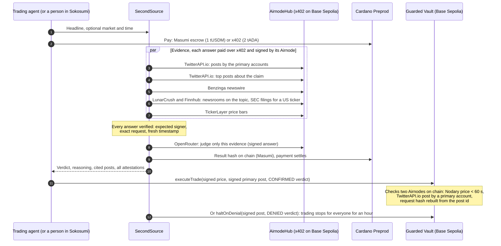

# SecondSource

**Trust the primary source, not the headline.** SecondSource is a coworker that AI trading agents hire before they act
on a market headline. It buys signed evidence from primary sources, has it judged, and answers `CONFIRMED`,
`UNCONFIRMED` or `DENIED`, with a receipt for every step. Its Guarded Vault on Base Sepolia only trades when it can
verify, on chain, a primary-source post signed by an Airnode.

- Live site: https://secondsource-two.vercel.app
- Ask it a question and pay from your own wallet: https://secondsource-two.vercel.app/check
- Test the contract yourself: https://secondsource-two.vercel.app/vault
- Guarded Vault v2 on Base Sepolia: [`0x0e9128f550254ed3389330e8134cea8cb09f46b6`](https://sepolia.basescan.org/address/0x0e9128f550254ed3389330e8134cea8cb09f46b6)

## The problem

On 7 April 2025 at 10:12 New York, a headline said Trump was considering a 90-day tariff pause. The Dow swung about 800
points. About twenty minutes later the White House said the report was wrong, and the rally faded. Agents that traded on
the headline lost money. The correction existed, on the primary source's own account, but nothing checked it before the
order went out.

We ran SecondSource on that headline. It answers **DENIED**, citing three posts by @RapidResponse47 from 14:38 to 14:41
UTC, each signed by the TwitterAPI.io Airnode: "Wrong. Fake News." and "Reports that @POTUS is considering a 90-day
pause on tariffs are FAKE NEWS". [Replay the check](https://secondsource-two.vercel.app/check?replay=hassett-2025-04-07).

## For judges: one minute per track

**API3, tamper test (pass/fail).** Open https://secondsource-two.vercel.app/vault?run, or run:

```sh
pnpm tamper-test
```

```
1. Valid, timely response from the Nodary Airnode          ACCEPTED: ETH/USD 2245.69
2. Real response with one value edited                     REVERTED SignatureMismatch
3. Real response that is too old                           REVERTED PriceResponseTooOld
4. Real response to a different request (BTC/USD)          REVERTED WrongRequest
5. Response signed by a key that is not the Nodary Airnode REVERTED UnexpectedAirnode
1 accepted, 4 rejected with 4 distinct reasons: PASS (1.3 s)
```

Each case calls `verifyPrice` on the deployed contract (eth_call, no gas, no keys). To send your own response, paste it
on `/vault`, POST it to `https://secondsource-two.vercel.app/api/vault/verify`, or run
`pnpm vault:verify response.json` (`--post <id>` for a TwitterAPI.io post, `--fresh` for a new signed price). The
same five cases run offline as Foundry tests: `pnpm tamper-test --offline`.

**Cardano, a paid job from start to finish.** A Sokosumi task paid 1 tUSDM through Masumi escrow on Preprod. The check
returned DENIED with a signed model judgment, the result hash went on chain, the task completed and SecondSource
collected the payment:

| Step | Cardano Preprod transaction |
|---|---|
| Escrow funded (FundsLocked) | [b74e743b…](https://preprod.cardanoscan.io/transaction/b74e743b2848b4919a73c99a814ad92471f5971d4aba15bd1e0ad3cd5fa086f3) |
| Result hash on chain (ResultSubmitted) | [721423f3…](https://preprod.cardanoscan.io/transaction/721423f3f8809c86bd7ae6a3b0127c8454ef1ef1384d89899716b3808ece4879) |
| Payout to SecondSource (Withdrawn) | [665cf3d5…](https://preprod.cardanoscan.io/transaction/665cf3d555452c066826138e7dff9969191a4221331572ca9f389c5a717bd877) |
| Paid request over x402 (2 tADA) | [7616f0a5…](https://preprod.cardanoscan.io/transaction/7616f0a56d346e068d7af71f167ef8cbee8e12dc63eef3acec5cd8d0ba29cc44) |

**Ask it yourself, in the browser.** On https://secondsource-two.vercel.app/check, type a question about a headline in
plain words (or pick a suggestion). Pay with either wallet:
- **Cardano:** "Pay 2 tADA with a Cardano wallet" (Eternl or Lace on preprod; test ADA at
  https://dispenser.masumi.network).
- **USDC:** "Pay 0.10 USDC and investigate" (MetaMask or any EVM wallet on Base Sepolia, signed once, no gas; test USDC
  at https://faucet.circle.com).

The agent then plans the check: which primary accounts, which search words, which time window and market. You watch
it buy and verify each signed answer, and get the verdict in the chat. Agents use the same thing over HTTP at
`POST /api/x402/investigate` (`pnpm x402:buy --question "…"`).

Payment is tied to the result. The x402 payment settles only after the check succeeded, and Masumi escrow refunds the
buyer if no result hash is submitted before the deadline.

**TUM Blockchain Track.** See [`SECURITY.md`](SECURITY.md) for the threat model, trust assumptions and limits, and
[`contracts/src/GuardedVault.sol`](contracts/src/GuardedVault.sol): NatSpec throughout, 14 custom errors, no owner, no
external calls. 30 Foundry tests cover every revert path on real signed responses.

## How it works



### The Guarded Vault

SecondSource can misjudge, but it cannot invent a White House post. A trade needs three proofs, all checked by
[`GuardedVault.sol`](contracts/src/GuardedVault.sol):

1. **Price.** `verifyPrice` checks an ETH/USD response from the Nodary Airnode signed less than 60 seconds ago.
2. **Primary source.** `verifyPrimarySource` checks a post fetched with `tweetsByIds` and projected to author, time, id
   and text, signed by the TwitterAPI.io Airnode. The contract **rebuilds the request hash from the post id**, so it
   knows which post the signature is about. It reads the author with `ProjectedJson` and requires an account fixed at
   deployment: @RapidResponse47, @WhiteHouse or @PressSec.
3. **Verdict.** A CONFIRMED verdict signed by SecondSource that commits to this chain, this vault and that exact post,
   used once.

Anyone holding a signed primary-source denial and a matching DENIED verdict can call `haltOnDenial`, which stops trades
for an hour. One agent's check protects every agent using the vault. The watchdog agent (`pnpm watchdog "rumour"`) does
this on its own: each cycle it pays for fresh evidence over x402 and halts the vault as soon as a primary account
denies the rumour.

Signature recovery and the final check use `AirnodeV2Attestation` from the
[API3 starter](https://github.com/api3dao/airnodehub-hackathon-starter), unmodified.

## Run it

You need Node 24, pnpm 10 and, for the contracts, [Foundry](https://getfoundry.sh).

```sh
git clone --recurse-submodules https://github.com/raglibol-re/SecondSource.git
cd SecondSource
pnpm install
pnpm test                 # 34 TypeScript tests
pnpm contracts:test       # 30 Foundry tests, including the tamper suite, on real signed responses
pnpm tamper-test          # the tamper test against the deployed contract (read-only, no keys needed)
```

With keys in `.env` (`cp .env.example .env`, then `pnpm wallet:new` and `pnpm vault:signer`):

```sh
pnpm faucet               # Base Sepolia ETH for gas (CDP key), or fund the printed address yourself
pnpm mint                 # aUSD from the AirnodeHub faucet, to pay for evidence
pnpm check "Hassett: Trump considering 90-day tariff pause" --asset indices/US30 --at 2025-04-07T14:12:00Z
pnpm agent "Hassett: Trump considering 90-day tariff pause" --naive   # the agent that buys on any headline
pnpm agent "Hassett: Trump considering 90-day tariff pause" --asset indices/US30 --at 2025-04-07T14:12:00Z
pnpm vault:act public/runs/shipbuilding-2025-04-09.json             # trade (CONFIRMED) or halt (DENIED)
pnpm watchdog "Hassett: Trump considering 90-day tariff pause" --at 2025-04-07T14:12:00Z
pnpm x402:wallet --fund && pnpm x402:buy "Hassett: Trump considering 90-day tariff pause"
pnpm worker               # the Sokosumi coworker (Masumi setup: docs/setup-human-steps.md)
pnpm site:local           # the website on http://127.0.0.1:4021, works offline for recorded checks
```

Every step that needs an account, a faucet or a browser is listed in
[`docs/setup-human-steps.md`](docs/setup-human-steps.md).

### Environment variables

| Name | Used by | Purpose |
|---|---|---|
| `PAYER_PRIVATE_KEY` | checks, vault scripts, Vercel | Base Sepolia account that pays AirnodeHub over x402 and sends vault transactions |
| `COWORKER_SIGNER_KEY` | vault scripts | Key SecondSource signs verdicts with |
| `BLOCKFROST_API_KEY_PREPROD` | x402 buyer, Masumi | Cardano Preprod access |
| `BUYER_CARDANO_MNEMONIC` | `x402:buy` | Demo buyer agent's Cardano wallet |
| `CDP_API_KEY_ID`, `CDP_API_KEY_SECRET` | `faucet` | Coinbase faucet for Base Sepolia ETH |
| `COWORKER_ID`, `PAID_TASKS_ENABLED` | worker | Sokosumi coworker, paid mode |
| `MPS_URL`, `MPS_ADMIN_KEY`, `MPS_RUNTIME_TOKEN`, `MPS_WALLET_ID`, `MPS_SOURCE_ID` | worker, registry | Masumi Payment Service |
| `JUDGE_MODELS` | judge | OpenRouter models to try in order |
| `DEMO_KEY` | `api/check` | Unlocks the live-check tab on the website (optional) |

Keys live in `.env`, which is gitignored. Testnets only.

## All proofs

| What | Where |
|---|---|
| Guarded Vault v2 deployment | [0x945c23b8…](https://sepolia.basescan.org/tx/0x945c23b8bdeb69729a2a1fdbb6705a6bfe10858b09ecc7e8f1a28cb4c0983304) |
| Trade allowed: CONFIRMED, @WhiteHouse post verified on chain | [0x0cd73b4e…](https://sepolia.basescan.org/tx/0x0cd73b4e626ef8b67573b9bb02883cbb7db849b088d9e7daaadc16a4e83913ed) |
| Halt: DENIED, @RapidResponse47 "FAKE NEWS" post verified on chain | [0x5c634248…](https://sepolia.basescan.org/tx/0x5c63424838f7ba6c39907eca6fa8c4986fd61f99d90dd31554b5df4643fb9617) |
| Another agent's confirmed trade refused during the halt (`TradingHalted`) | [0x96c8be5a…](https://sepolia.basescan.org/tx/0x96c8be5af7c64952723813b94a5de20c04c082b075946a75985581522f302eb4) |
| Watchdog halt after one paid cycle | [0xd3d341d8…](https://sepolia.basescan.org/tx/0xd3d341d8c0c8f60af5bfcf30299209f733b024cf35bc08d138498f3005b5f8d1) |
| Masumi registration of SecondSource | [c92eccbf…](https://preprod.cardanoscan.io/transaction/c92eccbff8cfe3ba56d8784466a2adbf48ae26e37403a3811e8b87932681caac) |
| Paid Masumi job: escrow, result hash, payout | See "For judges" above |
| x402 payments for evidence (aUSD on Base Sepolia) | Every one in [`docs/transactions.md`](docs/transactions.md) |

The first vault (v1, `0x20b2…4ea8`) and its transactions stay in the log as history.

## Limits

- **Relevance isn't checked on chain.** The vault checks that a cited post is authentic and from a primary account, not
  that it is about the headline. That judgment is SecondSource's, and it is signed.
- **Free judge model.** The OpenRouter Airnode refused paid models upstream during the hackathon (HTTP 403), so the
  judge falls back to `nvidia/nemotron-3-ultra-550b-a55b:free`. If no model answers, fixed published rules decide, and
  the result says the judgment is unsigned.
- **Coverage.** No AirnodeHub listing covers Truth Social or official press-release feeds. Finnhub gives SEC filing metadata and links, not the filing text.
  Benzinga's topic filter is unreliable, so we filter the day's feed locally. TickerLayer keeps only hourly bars for
  older dates.
- **Primary accounts are fixed** to US policy accounts at deployment. Other markets need their own list.
- **The Sokosumi worker and the Masumi Payment Service run on the operator's machine.** The x402 endpoint runs on
  Vercel.
- **Hackathon code on testnets, not audited.** See [`SECURITY.md`](SECURITY.md).

## Repository

| Path | What it is |
|---|---|
| `contracts/` | Foundry: `GuardedVault.sol`, `AirnodeV2Attestation.sol` and `ProjectedJson.sol` from the API3 starter, tests, real fixtures |
| `src/airnode/` | Request hashing, attestation verification, x402 paying client, pinned Airnode addresses |
| `src/evidence/`, `src/judge/`, `src/check.ts` | The check: evidence, signed judgment, result hash |
| `src/vault/` | Verdict signing, signed posts, on-chain verification, trade and halt |
| `src/x402/` | Selling checks over x402 on Cardano |
| `src/coworker/` | Sokosumi worker, Masumi escrow flow, registry, payout |
| `src/scripts/` | CLIs: tamper test, agent, watchdog, wallets, local site |
| `api/`, `public/` | Vercel functions and the website |
| `docs/` | Transactions, submission checklist, Devfolio text, video and pitch scripts, setup steps |
